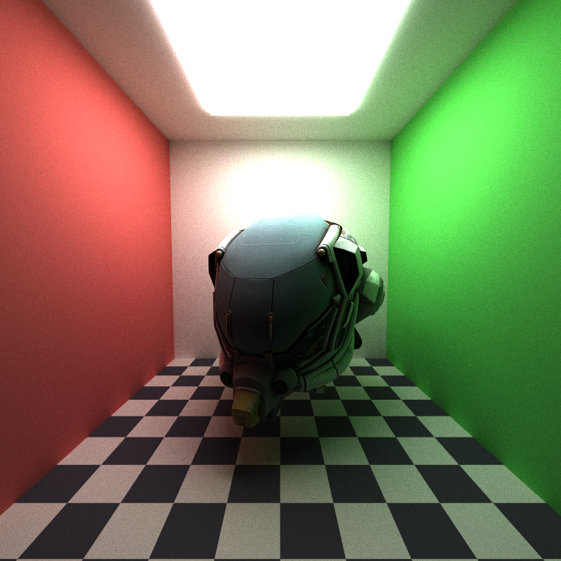
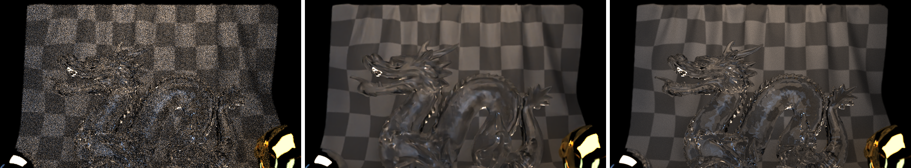
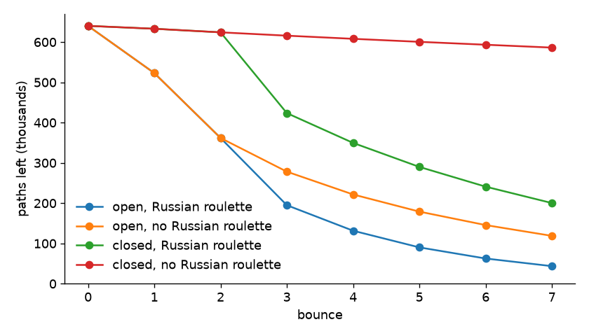
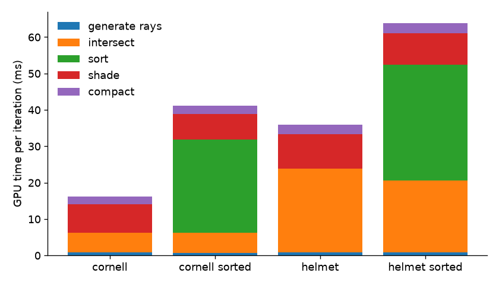
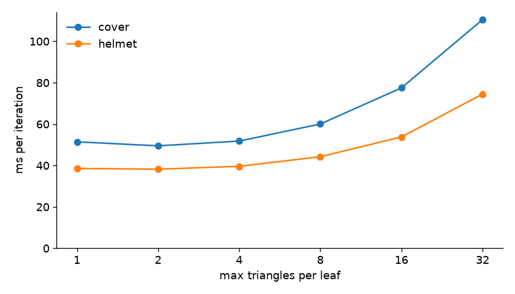

CUDA Path Tracer
================

**University of Pennsylvania, CIS 565: GPU Programming and Architecture, Project 3**

* Chen Cheng
  * [LinkedIn](https://www.linkedin.com/in/chen-andrew-cheng-34a133229/), [GitHub](https://github.com/ischencheng)
* Tested on: Windows 11, i5-12500H @ 2.50GHz 16GB, NVIDIA GeForce RTX 2050 4GB (personal laptop)

A glass Stanford dragon on a checker cloth, a gold glTF helmet, a mirror ball and a blue ball, with depth of field. 1280x720, 5000 samples per pixel, about 52 ms per sample on my laptop.

Features:

* Diffuse and perfect specular shading, stream compaction, sorting by material, stochastic antialiasing
* Refraction with Fresnel reflection (Schlick's approximation)
* Depth of field with a thin lens
* glTF loading with bounding box culling
* Texture mapping and normal mapping from glTF files, and a procedural checker texture
* Russian roulette
* BVH built with binned SAH
* Open Image Denoise with albedo and normal guides

### Running

`cis565_path_tracer scenes/cover.json` opens the window like the base code, and the ImGui window has a checkbox for every toggle. I also added command line options, mostly for timing:

| option | meaning |
| --- | --- |
| `--headless` | render without a window, print the average time per iteration, save the image and exit |
| `--spp N` | number of iterations (samples per pixel) |
| `--warmup N` | iterations left out of the average time (10 by default) |
| `--no-compact`, `--sort`, `--no-cull`, `--no-rr`, `--no-bvh` | turn a feature off (or sorting on) |
| `--leaf N` | max triangles in a BVH leaf (4 by default) |
| `--denoise` | also save a denoised image (see Open Image Denoise) |

New things in the scene files: `"Refractive"` materials with an `"IOR"`, `"CHECKER"` (cells per unit) and `"RGB2"` for the procedural checker, `"APERTURE"` (lens radius) and `"FOCUS"` in the camera, and `"TYPE": "mesh"` objects with a `"FILE"` (`.gltf` or `.glb`, relative to the scene file). A mesh without a `"MATERIAL"` uses its own glTF materials. I also fixed how the base code turns the camera from the scene file into angles, so cameras that look up or down work now.

### Diffuse and Specular Shading

Every bounce runs three steps: `computeIntersections` finds the closest hit of each path, `shadeMaterial` updates the path color and picks the next ray, and stream compaction removes the paths that are done. For a diffuse surface I use the cosine-weighted hemisphere function from the base code. Its pdf is cos θ / π and the BRDF is albedo / π, so after dividing by the pdf the path color is just multiplied by the albedo. A perfect mirror always reflects with `glm::reflect`. When a path hits a light, its color times the light color and emittance is added to the image, and the path ends.

### Stream Compaction

After shading, `thrust::remove_if` removes the paths that hit a light, left the scene or used up their bounces, so the next bounce only launches threads for live paths. Every finished path has already added its color to the image, so nothing needs to be kept for a final gather.

### Sorting by Material

When this is on, I write the material id of every hit into a key array, sort (key, index) pairs with `thrust::sort_by_key`, and then move the paths and intersections into the sorted order with `thrust::gather`, so paths with the same material are next to each other before shading and each big struct only moves once. Misses and finished paths get key -1. It is off by default because it made every scene I tried slower.

### Stochastic Antialiasing

Without antialiasing every sample of a pixel goes through the pixel center, so an edge is either fully in or fully out of the pixel. I add a random offset in [-0.5, 0.5] to the pixel position of every camera ray, so over many iterations a pixel averages the whole area it covers. This is a crop of the mirror ball (scaled 3×), left without and right with antialiasing.

### Refraction

The glass material uses Snell's law for the refracted direction and Schlick's approximation for the part of the light that is reflected:

$$R(\theta) = R_0 + (1 - R_0)(1 - \cos\theta)^5, \quad R_0 = \left(\frac{1 - n}{1 + n}\right)^2$$

At every hit I pick reflection with probability R and refraction otherwise, so the path color doesn't need a weight. The intersection tests tell me if the ray comes from outside, which decides if the index ratio is 1/n or n, and θ is the angle on the air side. When a ray inside the glass hits the surface at a steep angle, there is no refracted ray (total internal reflection) and it always reflects. The cube shows a lot of this.

### Depth of Field

A pinhole camera makes everything sharp. With a thin lens only the points at the focal distance are sharp. I first find where the pinhole ray hits the focal plane, then move the ray origin to a random point on the lens disk and aim the ray at that point. Points on the focal plane always land on the same pixel, and points in front of or behind it get spread out. Here the focus is on the yellow ball.

### glTF Loading

I use tinygltf to read `.gltf` and `.glb` files. The loader walks the node tree, multiplies the node transforms with the transform from the scene file, and stores every triangle in world space with its vertices, normals and uvs. A mesh object keeps its range in the triangle array and its bounding box. The ray-triangle test is Möller-Trumbore, which also gives the barycentric coordinates I use to interpolate the normals. With bounding box culling, a ray first tests the mesh box and skips all its triangles if it misses the box or the box is farther than the closest hit so far. Each glTF material becomes a diffuse material with its base color, and materials with the `KHR_materials_transmission` extension become my glass material, which is how the dragon on the cover gets its look. In this image the scene file gives the helmet a white material.

### Texture Mapping and Normal Mapping

The loader copies the base color and normal textures of the glTF materials into one big RGBA8 buffer on the GPU, and each texture keeps its size and offset in that buffer. The shading kernel samples them with bilinear filtering. For the normal map, I compute a tangent for every triangle from how the uvs change along its edges, build a tangent frame at the hit point, and turn the texel into a world space normal. The floor uses a procedural checker instead: the color depends on whether floor(x) + floor(y) + floor(z) of the hit point is even or odd, so it also works on spheres and cubes, which have no uvs. The cloth on the cover gets its checker pattern from its glTF texture.

### Russian Roulette

After 3 bounces, a path keeps going with probability q = max(r, g, b) of its color (at most 0.95), and when it survives its color is divided by q. Dark paths add very little to the image, so stopping most of them saves work, and dividing by q keeps the average the same.

### BVH

Testing every triangle is far too slow for the cover scene, which has 150k triangles. I build a BVH for every mesh on the CPU. A node splits its triangles along the longest axis of their centroids with binned SAH: the centroids go into 16 bins, and for each of the 15 cuts between bins I estimate the cost as (triangles in a child) × (surface area of the child's box), summed over both children, and take the cheapest cut. A node becomes a leaf at 4 triangles (`--leaf`). The tree is stored in a flat array where the two children of a node sit next to each other. There is no recursion on the GPU, so the traversal keeps a small stack of node indices. At an interior node it tests both child boxes and pushes the nearer one last, so it is visited first and the closest hit distance shrinks sooner, which lets more far boxes be skipped.

### Open Image Denoise

Open Image Denoise is a neural network filter from Intel that removes Monte Carlo noise. Besides the noisy image, it can take the albedo and the normal of the first hit as guides. They have no lighting noise, so they tell the filter where the edges and textures are and it doesn't blur them away. During the first bounce I add the material color (after textures) and the shading normal of every hit into two more buffers, in the same way the image adds up samples. When I save an image with `--denoise` (or the checkbox), I download the three buffers, divide them by the number of samples, run the `RT` filter with `hdr` on, and save `name.denoised.png` next to the normal image. The filter only runs when saving, so it doesn't slow down rendering. I ask for the CUDA device by name, because the default device pick also tries the Intel GPU of my laptop and fails there.

From left to right: 32 samples, the same 32 samples denoised, and 5000 samples without denoising. The cloth comes out very clean, but the details inside the glass dragon get smoothed away, because the albedo and normal of the first hit don't know what is seen through the glass.

This table shows the average difference from the 5000 sample image (pixel values 0 to 255).

| samples | raw | denoised |
| --- | --- | --- |
| 32 | 12.3 | 1.9 |
| 256 | 4.3 | 1.4 |

32 denoised samples are closer to the 5000 sample image than 256 raw samples. Denoising one 1280x720 image takes 34 ms on the CUDA device and 371 ms on the CPU device (my i5-12500H), measured with `oidnBenchmark`. On the GPU that is less than one iteration of the cover, so it would even be cheap enough to denoise the preview every few iterations.

Open Image Denoise is not in the repo because its binaries are about 80 MB. To build with it, download the Windows release (I used 2.5.1) from the [OIDN releases](https://github.com/OpenImageDenoise/oidn/releases) and unzip it into `external/oidn`. I changed `CMakeLists.txt` so it finds the package there, links it and copies its DLLs next to the exe. Without it everything still builds, and `--denoise` only prints a message.

### Performance Analysis

All times are the average ms per iteration (one sample per pixel) of a Release build, from `--headless --spp 210`, which leaves out the first 10 iterations. My laptop GPU changes its clock under long full load, so the same setting can be up to 20% faster or slower in another run. Because of that I ran the settings of each table in 3 rounds (every setting once per round) and took the middle run of each setting, so the numbers in one table were measured in the same state and can be compared. Inside a table the 3 runs were within about 1% of each other. If I don't say otherwise, compaction, bounding box culling, Russian roulette and the BVH are on and sorting is off. The Cornell scenes and `cornell_helmet` are 800x800 with depth 8, and the cover is 1280x720 with depth 12. `cornell_closed` is the Cornell box with a fourth wall behind the camera, so no ray can leave.

### Stream Compaction in One Iteration

This chart shows how many of the 640k paths are still alive after each bounce in the first iteration. In the open box 18% of the paths are already done after the first bounce (they left through the open side or hit the light), and after 7 bounces only 18.5% are left, even without Russian roulette. In the closed box nothing can leave, so without Russian roulette a path only ends when it hits the light, and 91.6% are still alive after 7 bounces. Russian roulette starts after bounce 3 and pulls both curves down.

This table shows the time per iteration in ms with and without compaction.

| scene | compaction + RR | no compaction + RR | compaction, no RR | no compaction, no RR |
| --- | --- | --- | --- | --- |
| cornell (open) | 19.00 | 26.09 | 22.44 | 28.84 |
| cornell_closed | 30.92 | 35.45 | 43.30 | 37.16 |

In the open box compaction saves 27% with Russian roulette and 22% without. Without compaction a finished path still gets a thread at every bounce. The thread returns right away, but the live paths are spread over all the warps, so many more warps have to run. In the closed box without Russian roulette, compaction makes it 17% slower. Almost no path ends there, so `remove_if` reads and writes all 640k paths (44 bytes each) at every bounce and removes almost nothing. This is what I expected, because compaction only helps when paths end. With Russian roulette many closed-box paths end after bounce 3, and then compaction is 13% faster again.

### Material Sorting

This table shows the time per iteration in ms with and without sorting by material.

| scene | materials | no sorting | sorting |
| --- | --- | --- | --- |
| cornell | 5 | 19.02 | 45.67 |
| cornell_glass | 7 | 20.68 | 48.65 |
| cornell_helmet | 5 | 40.10 | 69.82 |
| cover | 7 | 52.41 | 68.27 |

This chart shows the GPU time of each step per iteration, measured with Nsight Systems.

* **Sort the rays/path segments so that rays/paths interacting with the same material are contiguous in memory before shading. How does this impact performance? Why?**
  * In my scenes sorting always makes it slower: the Cornell box goes from 19.0 to 45.7 ms, and the cover from 52.4 to 68.3 ms. The chart shows why. Shading does get about 10% faster with sorting (7.8 to 7.0 ms in the Cornell box), and in the helmet scene even the intersection gets 14% faster, because rays that hit the same material also hit the same object and walk the same part of the BVH. But the sort costs 26 to 32 ms per iteration: 8 radix sorts of up to 640k keys, plus moving the paths and intersections into the new order. My materials are small branches (diffuse, mirror and glass are a few lines each), so a warp with mixed materials doesn't lose much time to divergence. I think sorting would only pay off with many expensive materials, or with a cheaper sort, for example sorting only on some bounces or only on the few bits the material id needs.

### Passing Geometry by Reference

This table shows the time per iteration of the Cornell box before and after this change (both without Russian roulette and BVH, which came later).

| `Geom` passed to the intersection tests | ms per iteration |
| --- | --- |
| by value (base code) | 62.89 |
| by const reference | 15.50 |

The base code compiles every `.cu` file on its own (separable compilation), so `computeIntersections` in `pathtrace.cu` can't inline `boxIntersectionTest` from `intersections.cu` and really calls it. The base code passes the `Geom` by value, and a `Geom` holds three 4x4 matrices (more than 200 bytes), so every call first copies it into local memory. With 7 objects and up to 8 bounces, that is up to 56 copies per pixel per iteration. A const reference only passes a pointer, and this one-word change made the whole iteration 4.1× faster. `scatterRay` in `interactions.cu` is still a real call, and the shading kernel is now the biggest step in the Cornell box (7.8 ms of GPU time per iteration in the chart above), so moving it into a header where it can be inlined is probably the next easy speedup.

### Russian Roulette Speedup

From the compaction table, Russian roulette makes the open box 15% faster (22.44 to 19.00 ms) and the closed box 29% faster (43.30 to 30.92 ms). It helps the closed box about twice as much, because there most paths would otherwise bounce all 8 times. The image converges to the same result, since the paths that survive are boosted by 1/q. Without compaction it helps much less (10% in the open box and 5% in the closed box), because a path stopped by Russian roulette still takes a slot in its warp until compaction removes it.

### BVH vs Bounding Box Culling

This table shows the time per iteration in ms for the three ways to find the closest triangle.

| scene | triangles | test all triangles | bounding box culling | BVH |
| --- | --- | --- | --- | --- |
| cornell_helmet | 15k | 2014 | 1591 | 39.6 |
| cover | 150k | | 14600 | 51.9 |

The culling only helps rays that miss the whole mesh (21% for the helmet), and every ray that hits the box still tests all the triangles. With the BVH a ray tests a few boxes on each level and only the triangles in the leaves it reaches, so it is 40× faster than culling for the helmet and 281× for the cover. The cover has 10× more triangles than the helmet but is only 1.3× slower, and most of that is its larger image and deeper paths. I didn't run the cover without culling, since even with culling one iteration takes 15 seconds.

This chart shows the time for different max leaf sizes. Leaves of 2 triangles are the fastest for both scenes, 4 is within about 5%, and bigger leaves get slow quickly, because the ray has to test every triangle in a leaf and a triangle test costs more than a box test. Leaves of 1 make the tree deeper, so each ray tests more boxes. I kept 4 as the default because it is almost as fast and has about half as many nodes as 2.

### File Textures vs Procedural Texture

This table shows the textured helmet scene with its glTF textures and with the procedural checker on the helmet.

| helmet material | ms per iteration |
| --- | --- |
| glTF textures (base color and normal map) | 31.36 |
| procedural checker | 30.81 |

The file textures are only 2% slower. A texture lookup reads 4 texels for the bilinear filter, and the normal map needs a second lookup and the tangent of the triangle, while the checker only needs a few `floor()` calls. But only the rays that hit the helmet pay for this, and the time is mostly spent finding intersections.

### GPU vs CPU and Next Steps

* **Antialiasing and depth of field** only add a few random numbers and a little math per camera ray, too little to measure. They fit the GPU well since every pixel does the same work. Stratified or low discrepancy samples would make the noise go away faster.
* **Refraction** costs about as much as the other materials. On the GPU, glass, mirror and diffuse paths in the same warp run their branches one after another, which a CPU doesn't care about. A rough glass (microfacet) model would look more realistic.
* **glTF loading** stores every triangle in world space with its normals, uvs and a tangent (116 bytes). That is simple, but copies of the same mesh would use memory again; instancing with one transform per object would fix that.
* **Textures** live in one big buffer, and I filter them by hand. CUDA texture objects would do the bilinear filter in hardware and use the texture cache.
* **Russian roulette** saves the same work on a CPU, but on the GPU most of the gain only comes together with compaction (see above).
* **The BVH** is the feature where the GPU has the hardest time. Rays in the same warp walk different parts of the tree and the stack lives in local memory, while a CPU core walks a tree with recursion and big caches. The GPU still wins by running thousands of rays at once. A BVH with 4 children per node and smaller nodes would read less memory per ray, and building the tree on the GPU would make loading big scenes faster.

### Debugging

When I first added the glass cube, its edges came out black, while the glass sphere looked fine. The black parts were where a ray inside the cube hits a side face at a steep angle, so it should be totally reflected. I checked for total internal reflection by testing if `glm::refract` returned a zero vector, but the GLM version in the base code computes `sqrt(k)` before multiplying by `k >= 0`, so it returns NaN when k < 0. The NaN direction missed everything and the path died. Now I compute k myself and reflect when it is negative.

### Credits

* [Open Image Denoise](https://github.com/OpenImageDenoise/oidn) 2.5.1 (not in the repo, see above)
* [tinygltf](https://github.com/syoyo/tinygltf) v2.9 for reading glTF files, and the newer [stb_image](https://github.com/nothings/stb) v2.30 that it needs
* [Damaged Helmet](https://github.com/KhronosGroup/glTF-Sample-Assets/tree/main/Models/DamagedHelmet): © 2016 theblueturtle_ (CC BY-NC 4.0), rebuilt © 2018 ctxwing (CC BY 4.0)
* [Dragon Attenuation](https://github.com/KhronosGroup/glTF-Sample-Assets/tree/main/Models/DragonAttenuation): dragon © 1996 Stanford University Computer Graphics Laboratory, converted by Morgan McGuire; cloth backdrop by Adobe (CC0)
* [PBRT v4](https://pbr-book.org/4ed/contents) for the thin lens, Fresnel and BVH chapters
