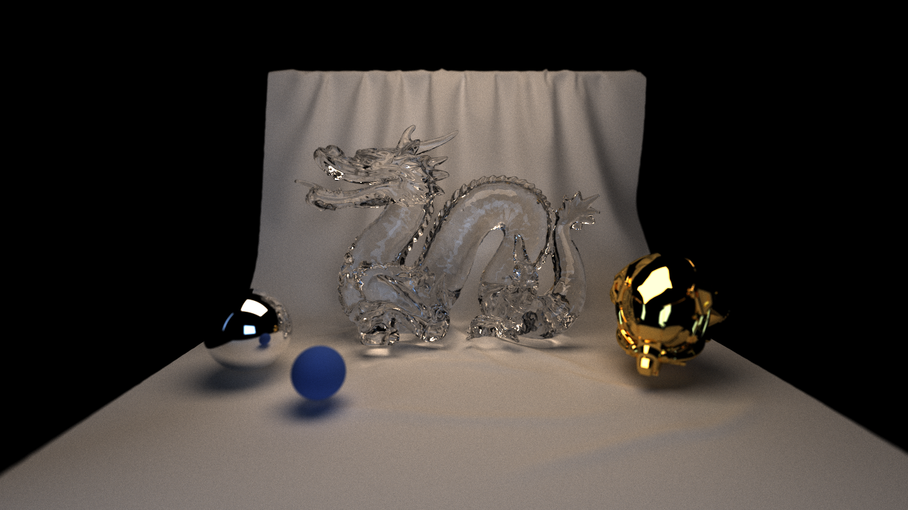
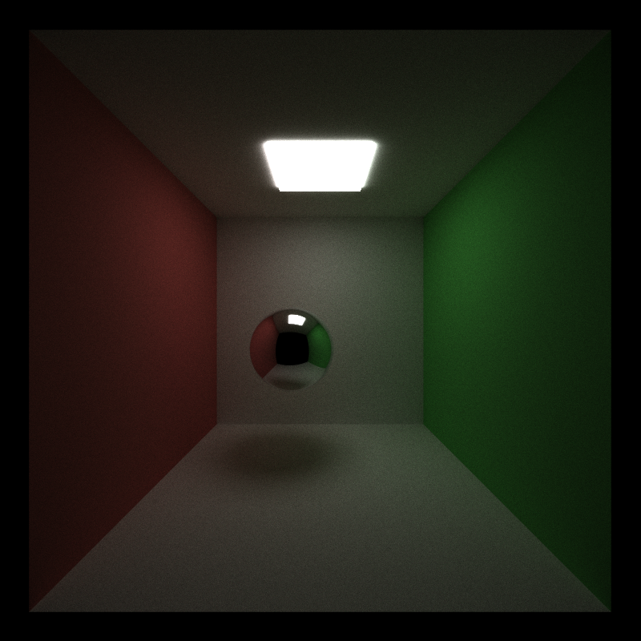
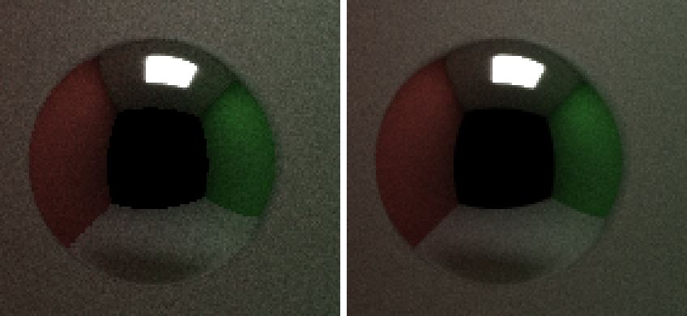
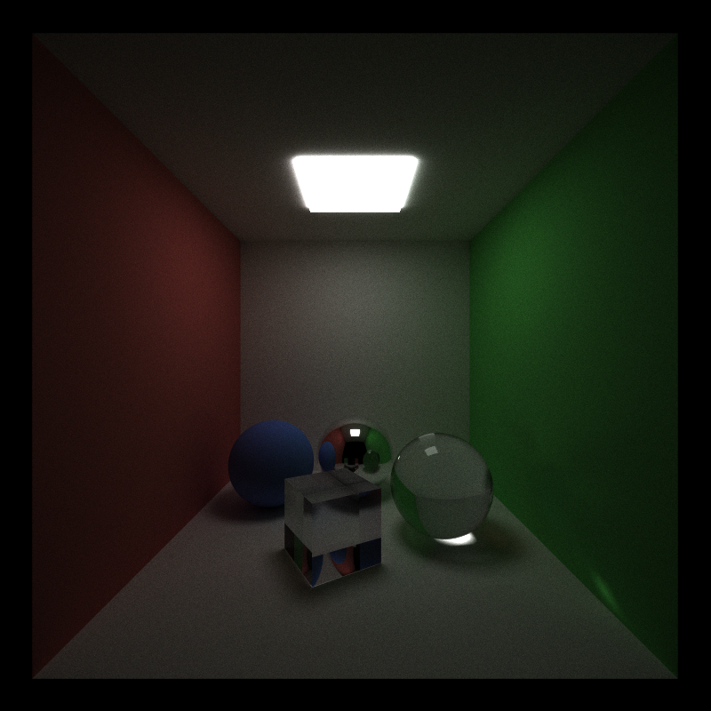
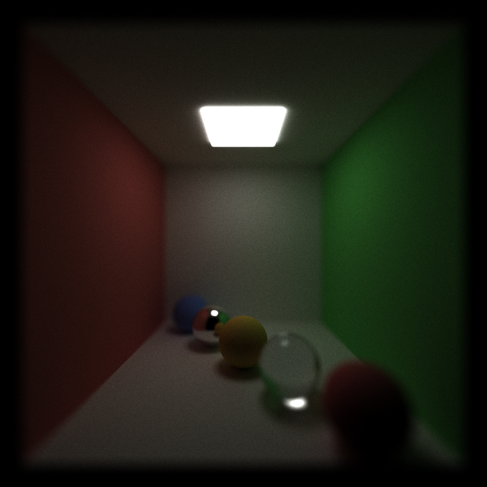
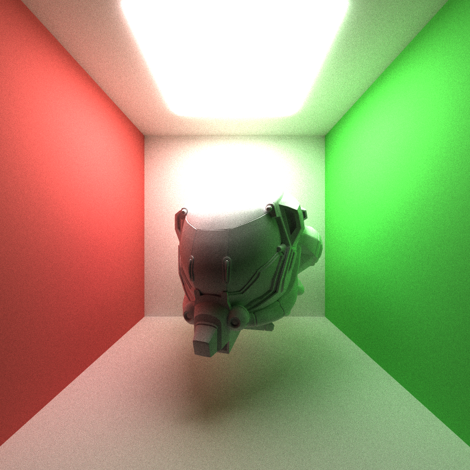
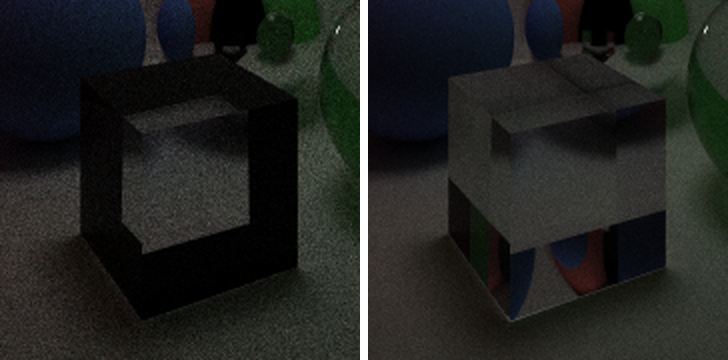

CUDA Path Tracer
================

**University of Pennsylvania, CIS 565: GPU Programming and Architecture, Project 3**

* Chen Cheng
  * [LinkedIn](https://www.linkedin.com/in/chen-andrew-cheng-34a133229/), [GitHub](https://github.com/ischencheng)
* Tested on: Windows 11, i5-12500H @ 2.50GHz 16GB, NVIDIA GeForce RTX 2050 4GB (personal laptop)

A glass Stanford dragon on a cloth backdrop, a gold glTF helmet, a mirror ball and a blue ball, with depth of field. 1280x720, 5000 samples per pixel, about 44 ms per sample on my laptop.

Features:

* Diffuse and perfect specular shading, stream compaction, sorting by material, stochastic antialiasing
* Refraction with Fresnel reflection (Schlick's approximation)
* Depth of field with a thin lens
* glTF loading with bounding box culling
* Russian roulette
* BVH built with binned SAH

### Running

`cis565_path_tracer scenes/cover.json` opens the window like the base code, and the ImGui window has a checkbox for every toggle. I also added command line options, mostly for timing:

| option | meaning |
| --- | --- |
| `--headless` | render without a window, print the average time per iteration, save the image and exit |
| `--spp N` | number of iterations (samples per pixel) |
| `--warmup N` | iterations left out of the average time (10 by default) |
| `--no-compact`, `--sort`, `--no-cull`, `--no-rr`, `--no-bvh` | turn a feature off (or sorting on) |
| `--leaf N` | max triangles in a BVH leaf (4 by default) |

New things in the scene files: `"Refractive"` materials with an `"IOR"`, `"APERTURE"` (lens radius) and `"FOCUS"` in the camera, and `"TYPE": "mesh"` objects with a `"FILE"` (`.gltf` or `.glb`, relative to the scene file). A mesh without a `"MATERIAL"` uses its own glTF materials. I also fixed how the base code turns the camera from the scene file into angles, so cameras that look up or down work now.

### Diffuse and Specular Shading

Every bounce runs three steps: `computeIntersections` finds the closest hit of each path, `shadeMaterial` updates the path color and picks the next ray, and stream compaction removes the paths that are done. For a diffuse surface I use the cosine-weighted hemisphere function from the base code. Its pdf is cos θ / π and the BRDF is albedo / π, so after dividing by the pdf the path color is just multiplied by the albedo. A perfect mirror always reflects with `glm::reflect`. When a path hits a light, its color times the light color and emittance is added to the image, and the path ends.

### Stream Compaction

After shading, `thrust::remove_if` removes the paths that hit a light, left the scene or used up their bounces, so the next bounce only launches threads for live paths. Every finished path has already added its color to the image, so nothing needs to be kept for a final gather.

### Sorting by Material

When this is on, I write the material id of every hit into a key array, sort (key, index) pairs with `thrust::sort_by_key`, and then move the paths and intersections into the sorted order with `thrust::gather`, so paths with the same material are next to each other before shading and each big struct only moves once. Misses and finished paths get key -1. It is off by default because it made every scene I tried slower.

### Stochastic Antialiasing

Without antialiasing every sample of a pixel goes through the pixel center, so an edge is either fully in or fully out of the pixel. I add a random offset in [-0.5, 0.5] to the pixel position of every camera ray, so over many iterations a pixel averages the whole area it covers. This is a crop of the mirror ball (scaled 3×), left without and right with antialiasing.

### Refraction

The glass material uses Snell's law for the refracted direction and Schlick's approximation for the part of the light that is reflected:

$$R(\theta) = R_0 + (1 - R_0)(1 - \cos\theta)^5, \quad R_0 = \left(\frac{1 - n}{1 + n}\right)^2$$

At every hit I pick reflection with probability R and refraction otherwise, so the path color doesn't need a weight. The intersection tests tell me if the ray comes from outside, which decides if the index ratio is 1/n or n, and θ is the angle on the air side. When a ray inside the glass hits the surface at a steep angle, there is no refracted ray (total internal reflection) and it always reflects. The cube shows a lot of this.

### Depth of Field

A pinhole camera makes everything sharp. With a thin lens only the points at the focal distance are sharp. I first find where the pinhole ray hits the focal plane, then move the ray origin to a random point on the lens disk and aim the ray at that point. Points on the focal plane always land on the same pixel, and points in front of or behind it get spread out. Here the focus is on the yellow ball.

### glTF Loading

I use tinygltf to read `.gltf` and `.glb` files. The loader walks the node tree, multiplies the node transforms with the transform from the scene file, and stores every triangle in world space with its vertices and normals. A mesh object keeps its range in the triangle array and its bounding box. The ray-triangle test is Möller-Trumbore, which also gives the barycentric coordinates I use to interpolate the normals. With bounding box culling, a ray first tests the mesh box and skips all its triangles if it misses the box or the box is farther than the closest hit so far. Each glTF material becomes a diffuse material with its base color, and materials with the `KHR_materials_transmission` extension become my glass material, which is how the dragon on the cover gets its look. The helmet here uses its own material, which is white because I don't read its textures.

### Russian Roulette

After 3 bounces, a path keeps going with probability q = max(r, g, b) of its color (at most 0.95), and when it survives its color is divided by q. Dark paths add very little to the image, so stopping most of them saves work, and dividing by q keeps the average the same.

### BVH

Testing every triangle is far too slow for the cover scene, which has 150k triangles. I build a BVH for every mesh on the CPU. A node splits its triangles along the longest axis of their centroids with binned SAH: the centroids go into 16 bins, and for each of the 15 cuts between bins I estimate the cost as (triangles in a child) × (surface area of the child's box), summed over both children, and take the cheapest cut. A node becomes a leaf at 4 triangles (`--leaf`). The tree is stored in a flat array where the two children of a node sit next to each other. There is no recursion on the GPU, so the traversal keeps a small stack of node indices. At an interior node it tests both child boxes and pushes the nearer one last, so it is visited first and the closest hit distance shrinks sooner, which lets more far boxes be skipped.

### Debugging

When I first added the glass cube, its edges came out black, while the glass sphere looked fine. The black parts were where a ray inside the cube hits a side face at a steep angle, so it should be totally reflected. I checked for total internal reflection by testing if `glm::refract` returned a zero vector, but the GLM version in the base code computes `sqrt(k)` before multiplying by `k >= 0`, so it returns NaN when k < 0. The NaN direction missed everything and the path died. Now I compute k myself and reflect when it is negative.

### Credits

* [tinygltf](https://github.com/syoyo/tinygltf) v2.9 for reading glTF files, and the newer [stb_image](https://github.com/nothings/stb) v2.30 that it needs
* [Damaged Helmet](https://github.com/KhronosGroup/glTF-Sample-Assets/tree/main/Models/DamagedHelmet): © 2016 theblueturtle_ (CC BY-NC 4.0), rebuilt © 2018 ctxwing (CC BY 4.0)
* [Dragon Attenuation](https://github.com/KhronosGroup/glTF-Sample-Assets/tree/main/Models/DragonAttenuation): dragon © 1996 Stanford University Computer Graphics Laboratory, converted by Morgan McGuire; cloth backdrop by Adobe (CC0)
* [PBRT v4](https://pbr-book.org/4ed/contents) for the thin lens, Fresnel and BVH chapters
